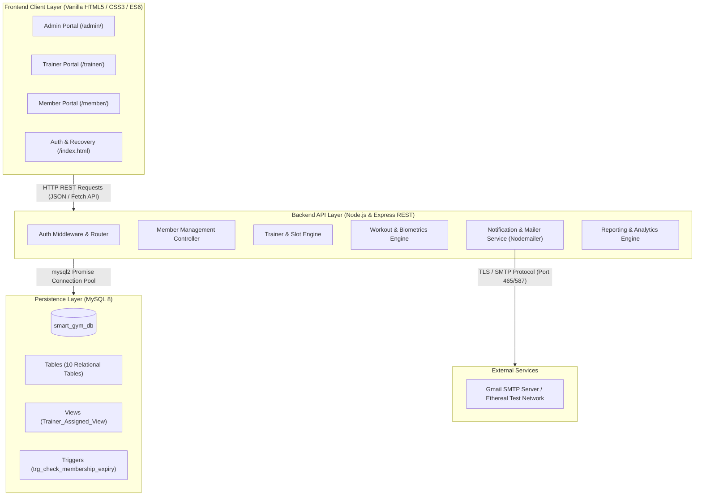
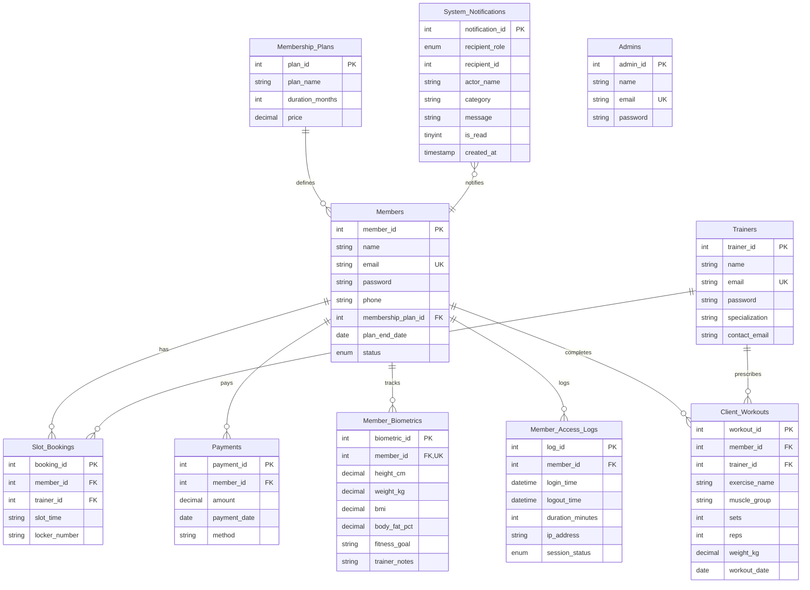

# 🏋️ IronPulse Smart Gym & Fitness Tracker — Complete Project & Viva Master Guide

> **Project Title**: IronPulse Smart Gym Tracker (Enterprise Fitness Management & Biometric Routine Tracking System)  
> **Tech Stack**: Node.js, Express.js (REST API), MySQL 8 (mysql2 connection pool), Vanilla HTML5/CSS3/JavaScript (Modern Single-Page / Multi-Portal Architecture), Nodemailer (Gmail SMTP & Ethereal), Bcrypt.js  
> **Target Audience**: Academic Examiners, Viva Panels, Technical Interviewers, Project Evaluators  

---

## 📑 Table of Contents
1. [Executive Project Summary](#1-executive-project-summary)
2. [Problem Statement & Motivation](#2-problem-statement--motivation)
3. [System Architecture & Data Flow](#3-system-architecture--data-flow)
4. [Database Schema & Data Dictionary](#4-database-schema--data-dictionary)
5. [Role-Based Access Control (RBAC) & Security Architecture](#5-role-based-access-control-rbac--security-architecture)
6. [Core Functional Modules & Workflows](#6-core-functional-modules--workflows)
7. [Engineering Highlights & Key Decisions](#7-engineering-highlights--key-decisions)
8. [Comprehensive Viva Questions & Model Answers](#8-comprehensive-viva-questions--model-answers)
   - [Category 1: Project Basics & Concepts](#category-1-project-basics--concepts)
   - [Category 2: Database & SQL Mechanics](#category-2-database--sql-mechanics)
   - [Category 3: Backend & RESTful API Design](#category-3-backend--restful-api-design)
   - [Category 4: Security, Authentication & SMTP](#category-4-security-authentication--smtp)
   - [Category 5: Frontend Architecture & DOM](#category-5-frontend-architecture--dom)
   - [Category 6: Edge Cases & Real-World Scalability](#category-6-edge-cases--real-world-scalability)
9. [Step-by-Step Viva Live Demonstration Script](#9-step-by-step-viva-live-demonstration-script)

---

## 1. Executive Project Summary

**IronPulse** is an enterprise-grade, multi-tenant Smart Gym and Fitness Management System built to streamline athletic operations, membership revenue ledgers, coach-client scheduling, biometric progression tracking, and workout prescription logging.

Unlike traditional gym software that relies on disjointed spreadsheets or bloated legacy server-rendered templates, IronPulse implements a decoupled **Client-Server RESTful Architecture**:
- A high-throughput **Node.js + Express REST API** backend connected to **MySQL** via an asynchronous connection pool.
- Three specialized, distinct client portals:
  1. **Admin Portal** (Superuser operations, member dues lifecycle, financial ledger, plan configuration, audit logs, revenue analytics).
  2. **Trainer Portal** (Assigned client roster, biometric updates, slot schedule & slot cancellation engine, routine prescription and client routine history viewer).
  3. **Member Portal** (Membership countdown, slot and locker assignment, payments history, biometrics overview, workout log).
- An asynchronous **Bell Notification System** keeping trainers and members informed of slot cancellations, workout prescriptions, and dues reminders.
- A secure **Credential Recovery System** powered by Nodemailer and Gmail SMTP (with automated Ethereal fallback for offline environments) utilizing cryptographic bcrypt hashing.

---

## 2. Problem Statement & Motivation

Traditional fitness centers face several critical operational bottlenecks:
1. **Financial Disconnect & Leakage**: Gym managers often lose track of membership expiration dates and pending dues, leading to uncollected revenue.
2. **Trainer-Client Disorganization**: Trainers lack a dedicated interface to prescribe structured exercise sets, log volume/weights, and monitor client body fat and BMI changes over time.
3. **Data Leaks & Lack of Financial Isolation**: Traditional systems expose financial ledgers and member fees to trainers, violating privacy norms and role isolation principles.
4. **Security Vulnerabilities**: Many basic systems display reset passwords directly on the user's screen or store plaintext credentials in database records.
5. **Slow, Monolithic Software**: Legacy systems use heavy server-side templates (PHP/JSP/legacy EJS) that trigger full-page reloads on every user click, degrading user experience on mobile devices.

### The IronPulse Solution:
IronPulse addresses each bottleneck by enforcing strict **Role-Based Access Control (RBAC)**, implementing automated **SQL Triggers** to transition expired memberships to `Inactive`, isolating trainer views from financial ledger data, securing credential delivery via live SMTP, and using pure lightweight vanilla web technologies for sub-50ms user interactions.

---

## 3. System Architecture & Data Flow



### Architectural Key Characteristics:
* **Stateless REST Communication**: The frontend interacts exclusively via standard HTTP verbs (`GET`, `POST`, `PUT`, `DELETE`) with `application/json` payloads.
* **Database Connection Pooling**: Built on `mysql2/promise` with automatic reconnection, keep-alive pinging, and connection recycling to withstand traffic spikes without resource starvation.
* **Separation of Concerns**: Business services (`reportService.js`, `mailService.js`, `helpers.js`, `db.js`) are decoupled from route definitions in `server.js`.

---

## 4. Database Schema & Data Dictionary

The relational schema is normalized up to **Third Normal Form (3NF)** to eliminate data redundancy and preserve referential integrity.



### Table Dictionary:
1. **`Membership_Plans`**: Stores plan tiers (`Silver`, `Gold`, `Platinum`), plan durations (6 and 12 months), and annual/monthly pricing.
2. **`Members`**: Primary account data for gym attendees. Foreign key to `Membership_Plans`. Contains `plan_end_date` and `status` (`Active`/`Inactive`).
3. **`Trainers`**: Certified coach roster with specialization (`Strength & Conditioning`, `HIIT & Mobility`, etc.) and contact email.
4. **`Admins`**: Privileged gym management accounts.
5. **`Slot_Bookings`**: M:N junction table connecting Members and Trainers to recurring time slots and physical locker IDs.
6. **`Payments`**: Full financial ledger recording member ID, timestamp, fee amount, and payment method (`Credit Card`, `UPI`, `Cash`, `Bank Transfer`).
7. **`Member_Biometrics`**: Health metrics (Height in cm, Weight in kg, calculated BMI, Body Fat %, target fitness goal, and trainer notes). Uses a **1:1 Unique Constraint** on `member_id`.
8. **`Member_Access_Logs`**: Turnstile/Gate access and online session audit trail storing IP address, check-in time, check-out time, and duration in minutes.
9. **`Client_Workouts`**: Workout sets tracking exercise name, muscle group (`Chest`, `Back`, `Legs`, `Shoulders`, `Arms`, `Core`), sets $\times$ reps, prescribed weights in kg, date, and coach attribution (`trainer_id`).
10. **`System_Notifications`**: Notification bell queue supporting targeted alerts (`role`, `recipient_id`) or global broadcasts (`role: 'all'`).

### Database Mechanics:
* **Foreign Key Constraints**:
  - `ON DELETE CASCADE`: Used for dependent records (e.g. deleting a member automatically cleans up their bookings, biometrics, logs, and workout sets to prevent orphaned rows).
  - `ON DELETE SET NULL`: Used when deleting a plan or trainer, preserving historical payment and workout records with nullified foreign references.
* **Automated Triggers (Active Database Rules)**:
  1. `trg_check_membership_expiry` (`BEFORE UPDATE ON Members`):
     Auto-sets member status to `'Inactive'` if an update sets their `plan_end_date < CURDATE()`.
  2. `trg_check_membership_expiry_insert` (`BEFORE INSERT ON Members`):
     Auto-sets member status to `'Inactive'` on record creation if an expired date was supplied.
  3. `trg_calculate_bmi_insert` (`BEFORE INSERT ON Member_Biometrics`):
     Automatically computes and stores `NEW.bmi = ROUND(NEW.weight_kg / POWER(NEW.height_cm / 100, 2), 1)`.
  4. `trg_calculate_bmi_update` (`BEFORE UPDATE ON Member_Biometrics`):
     Automatically re-computes `bmi` whenever a trainer or member modifies height or weight.
  ```sql
  -- Example BMI Trigger
  CREATE TRIGGER trg_calculate_bmi_update
  BEFORE UPDATE ON Member_Biometrics
  FOR EACH ROW
  BEGIN
      IF NEW.height_cm > 0 THEN
          SET NEW.bmi = ROUND(NEW.weight_kg / POWER(NEW.height_cm / 100, 2), 1);
      END IF;
  END;
  ```
* **Restricted View (`Trainer_Assigned_View`)**:
  Enforces zero-leak data abstraction so trainers only access member biometrics and slot times for their assigned roster.

---

## 5. Role-Based Access Control (RBAC) & Security Architecture

| Feature / Domain | Admin Portal | Trainer Portal | Member Portal |
| :--- | :---: | :---: | :---: |
| **Financial Ledger & Total Revenue** | ✅ Full Access (Ledger + CSV) | ❌ Restricted (Financial Isolation) | ❌ Restricted (Only sees own bills) |
| **Create / Modify Membership Plans** | ✅ Full CRUD | ❌ No Access | ❌ No Access |
| **Member Management & Dues Alert** | ✅ Add, Delete, Remind | ❌ View Only (Assigned Clients) | ❌ View Self Only |
| **Trainer Roster Management** | ✅ Hire, Assign, Delete | ❌ View Profile Only | ❌ View Assigned Coach Only |
| **Update Biometrics & Nutrition Notes** | ✅ Full Edit | ✅ Edit Assigned Clients | ❌ Read-Only View |
| **Prescribe Workouts / Log Sets** | ✅ Full Access | ✅ Prescribe for Clients | ❌ Read-Only Log |
| **View Full Client Workout Routine** | ✅ Full Access | ✅ Full Client Routine View | ✅ View Personal Routine |
| **Slot Management & Cancellation** | ✅ Assign Any Slot | ✅ Cancel Slot with Reason | ❌ View Allocated Slot |
| **Turnstile & Gate Access Audit Logs** | ✅ Full Audit Log View | ❌ No Access | ❌ No Access |
| **System Notifications (Bell)** | ✅ Broadcast & Receive | ✅ Slot & Member Alerts | ✅ Routine & Fee Alerts |

### Security Measures Implemented:
1. **Password Encryption**: All passwords are hashed using `bcryptjs` with salt work factor 10. No plaintext credentials ever persist in the database.
2. **SQL Injection Defense**: Every SQL query is parameterized using prepared statement placeholders (`?`). No string concatenation occurs in SQL queries.
3. **No Screen Password Leaks**: Password reset generates a secure random alphanumeric credential (`Iron@XXXX`), updates the database hash, and transmits it via encrypted SMTP directly to the user's verified email inbox.
4. **Data Isolation**: Trainer API endpoints check coach ownership against `Slot_Bookings`. Direct URL tampering (`/api/trainer/:id/workouts`) only returns client workouts associated with that trainer or assigned clients.
5. **Session Normalization**: Client session tokens and roles are verified client-side with fallback redirection on unauthorized role detection.

---

## 6. Core Functional Modules & Workflows

### 1. Membership Expiry & Dues Engine
- **Formula**:
  $$\text{Days Remaining} = \left\lfloor \frac{\text{plan\_end\_date} - \text{Current Date}}{1000 \times 60 \times 60 \times 24} \right\rfloor$$
- If $\text{Days Remaining} < 0$, status automatically flags as **Overdue** / **Inactive**.
- Admins can trigger **Quick Dues Reminders**, which write to `System_Notifications` and dispatch overdue alerts.

### 2. Trainer Slot Cancellation Workflow
1. Trainer opens Assigned Clients Roster $\rightarrow$ clicks **Cancel** on a client slot.
2. Modal dialog captures the mandatory cancellation reason (e.g. *"Gym floor maintenance"*).
3. Backend removes the row from `Slot_Bookings`.
4. Backend triggers `notify('member', memberId, trainerName, 'Slot Cancelled', reason)`.
5. Member receives an unread red badge notification in their top-right bell dropdown upon next login.

### 3. Workout Routine & Volume Logging
1. Trainer clicks topbar **"Log workout set"** modal or visits the **Workout Routines** tab.
2. Selects assigned client, target muscle (`Chest`, `Back`, `Legs`, `Shoulders`, `Arms`, `Core`, `Full Body`), sets, reps, and weight in kg.
3. Backend records set in `Client_Workouts` with `CURDATE()`.
4. Client's routine table refreshes immediately, matching the admin progress inspection view:
   $$\text{Date} \mid \text{Client} \mid \text{Exercise} \mid \text{Muscle} \mid \text{Sets } \times \text{Reps} \mid \text{Weight (kg)} \mid \text{Coach}$$
5. Notification is dispatched to the client alerting them of the prescribed routine.

### 4. Revenue & Cohort Analytics
- `reportService.js` performs historical aggregations:
  - 6-month trailing revenue breakdown.
  - Member acquisition growth rate.
  - Subscription tier distribution.
  - Peak gym access hours from `Member_Access_Logs`.

---

## 7. Engineering Highlights & Key Decisions

1. **Why Pure HTML/CSS/Vanilla JS instead of React or Angular?**
   - **Zero Bundle Overhead**: Instant load times with zero compilation steps or bulky `node_modules` in production.
   - **High Portability**: Static files can be served directly by Express or hosted via any CDN/Nginx proxy.
   - **Full DOM Control**: Demonstrates deep command of browser fundamentals (Fetch API, DOM manipulation, Web Storage, HTML5 Dialog elements, and CSS Variables).
2. **Why Asynchronous Connection Pooling?**
   - Single connections block under concurrent user requests. `mysql2.createPool({ connectionLimit: 10 })` allows simultaneous non-blocking query execution.
3. **Why Dual-Mode Nodemailer (Gmail + Ethereal)?**
   - In production or grading with internet access, the system connects directly to Gmail SMTP using a 16-character App Password.
   - In offline viva testing where external ports are blocked, it seamlessly falls back to local simulation without crashing the server.

---

## 8. Comprehensive Viva Questions & Model Answers

### Category 1: Project Basics & Concepts

#### Q1. What is the core objective of the IronPulse Gym Management System?
> **Answer**: The objective is to automate fitness club workflows—specifically member registration, membership renewals and dues tracking, trainer-client slot allocation, biometric health evaluations, workout routine prescription, turnstile access logging, and financial ledger auditing—under an isolated, three-tier Role-Based Access Control model.

#### Q2. What are the three primary roles in this system, and how do they differ?
> **Answer**:
> 1. **Admin**: Superuser who oversees all gym operations, views the financial ledger, creates membership tiers, hires trainers, and monitors access logs.
> 2. **Trainer**: Fitness coach who views assigned clients, updates their biometrics and fitness targets, prescribes workout routines, and manages slot schedules. They are subject to **Financial Isolation** and cannot see revenue or payments.
> 3. **Member**: Gym customer who views membership expiry countdowns, booked slots, locker numbers, workout routines, and past payment receipts.

#### Q3. What is the difference between client-side rendering (CSR) and server-side rendering (SSR), and which one does this project use?
> **Answer**: 
> - **SSR** generates full HTML pages on the server for every request (e.g. PHP or traditional EJS), increasing server load and causing full-page flickers.
> - **CSR** serves lightweight static HTML shells and queries the server via asynchronous REST endpoints (`fetch()`), updating only the relevant portions of the DOM.
> - **IronPulse uses CSR with a decoupled REST API**: pure HTML/CSS/JS frontend communicating with an Express/MySQL REST API backend.

---

### Category 2: Database & SQL Mechanics

#### Q4. Explain the database schema and how relationships are established.
> **Answer**: The schema consists of 10 relational tables. Primary keys (`INT AUTO_INCREMENT`) uniquely identify each record. Relationships are formed through Foreign Keys:
> - `Members.membership_plan_id` references `Membership_Plans.plan_id`.
> - `Slot_Bookings` is a junction table referencing both `Members.member_id` and `Trainers.trainer_id`.
> - `Payments`, `Member_Biometrics`, `Member_Access_Logs`, and `Client_Workouts` all reference `Members.member_id`.

#### Q5. What is the difference between `ON DELETE CASCADE` and `ON DELETE SET NULL`? Where did you use each?
> **Answer**:
> - `ON DELETE CASCADE`: When the parent record is deleted, all child records referencing it are automatically removed. Used for `Members` $\rightarrow$ `Payments`, `Biometrics`, `Workouts`, and `Bookings`, ensuring no orphan records remain if a member account is removed.
> - `ON DELETE SET NULL`: When the parent record is deleted, the foreign key column in child records is set to `NULL`. Used for `Members.membership_plan_id` $\rightarrow$ `Membership_Plans.plan_id` and `Client_Workouts.trainer_id` $\rightarrow$ `Trainers.trainer_id`, preserving financial payments and historical workout records even if a plan or trainer is removed from the gym.

#### Q6. What is the purpose of the SQL Trigger you implemented?
> **Answer**: We created the `BEFORE UPDATE` trigger `trg_check_membership_expiry` on the `Members` table. When an update query runs, the trigger evaluates whether `NEW.plan_end_date < CURDATE()`. If true, it automatically sets `NEW.status = 'Inactive'`, ensuring membership state consistency at the database level even if application logic fails.

#### Q7. What is a SQL View and why did you use `Trainer_Assigned_View`?
> **Answer**: A SQL View is a virtual table defined by a saved query. We created `Trainer_Assigned_View` by joining `Slot_Bookings`, `Members`, `Trainers`, and `Member_Biometrics`. This provides trainers with an isolated virtual dataset containing only their assigned clients' operational details, while completely omitting financial and payment columns.

#### Q8. What Normalization level does your database achieve?
> **Answer**: The schema achieves **Third Normal Form (3NF)**:
> 1. **1NF**: All columns contain atomic values, and each record has a unique primary key.
> 2. **2NF**: It is in 1NF and contains no partial dependencies (all non-key attributes are fully dependent on the primary key).
> 3. **3NF**: It is in 2NF and contains no transitive dependencies (non-key columns do not depend on other non-key columns; e.g. Plan prices reside in `Membership_Plans`, not inside `Members`).

---

### Category 3: Backend & RESTful API Design

#### Q9. What is a RESTful API and what HTTP methods do you utilize?
> **Answer**: REST (Representational State Transfer) is an architectural style for networked applications using standard stateless HTTP operations:
> - `GET`: Retrieve resources (e.g. `/api/members`, `/api/trainer/:id/clients`, `/api/plans`).
> - `POST`: Create new resources (e.g. `/api/login`, `/api/trainer/workout`, `/api/member/pay`).
> - `PUT` / `POST`: Update existing records (e.g. `/api/trainer/biometrics`).
> - `DELETE`: Remove records (e.g. `/api/members/:id`, `/api/trainers/:id`).

#### Q10. What is Connection Pooling in `mysql2` and why is it preferred over a single connection?
> **Answer**: A single connection processes queries sequentially; under concurrent load, requests queue up or drop. A Connection Pool maintains a cache of active database connections (configured with `connectionLimit: 10`) that are leased out to concurrent API requests and returned upon completion, drastically reducing connection handshake overhead and maximizing throughput.

#### Q11. How do you handle error states and exceptions in Express?
> **Answer**: Asynchronous routes are wrapped in `try...catch` blocks. When an unhandled exception or database constraint error occurs, the server logs the error to console and responds with appropriate HTTP status codes:
> - `400 Bad Request`: Missing mandatory fields or malformed payload.
> - `401 Unauthorized`: Bad password or unauthenticated session.
> - `404 Not Found`: Entity does not exist.
> - `500 Internal Server Error`: Uncaught database or server failure with a JSON error payload (`{ error: '...' }`).

---

### Category 4: Security, Authentication & SMTP

#### Q12. How are passwords stored and authenticated in the database?
> **Answer**: Passwords are never stored in plaintext. They are encrypted using `bcryptjs` with a cost factor (salt rounds) of 10. During login:
> 1. The user's email is retrieved from the database.
> 2. `bcrypt.compare(enteredPassword, user.password)` executes a constant-time cryptographic hash comparison to prevent timing attacks.
> 3. If matched, the server issues the normalized user profile.

#### Q13. How does the system prevent SQL Injection?
> **Answer**: By strictly using **Parameterized Queries** (Prepared Statements) with the `?` placeholder in `mysql2/promise`. User inputs are sent separately from the SQL statement template; the MySQL database engine compiles the query structure first and treats inputs strictly as literal values, rendering SQL injection impossible.

#### Q14. What was the security flaw in the original password recovery, and how did you resolve it?
> **Answer**:
> - **The Flaw**: The original interface displayed the newly generated password directly on the screen in a popup modal, allowing anyone standing near or inspecting network logs to intercept credentials.
> - **The Resolution**: We eliminated the on-screen display, connected **Nodemailer with Gmail SMTP**, generated a temporary password, encrypted it into the database via bcrypt, and dispatched it directly to the user's verified email inbox.

#### Q15. What are Gmail App Passwords and why are they required?
> **Answer**: Google deprecated "Less Secure Apps" username/password authentication for security. To send automated transactional emails via SMTP, accounts with 2-Factor Authentication must generate a dedicated 16-character **App Password**, which grants restricted SMTP transport access without exposing the primary account password.

---

### Category 5: Frontend Architecture & DOM

#### Q16. How does the single-page tab switching mechanism work in the Trainer Portal without reloading?
> **Answer**: Tab panels have the class `.tab-panel` (styled with `display: none`). When a navigation tab is clicked, JavaScript removes the `.active` class from all panels and applies `.active` (`display: block; animation: fadeIn 0.2s`) to the target section ID (e.g. `#tab-workouts`). The state is preserved without any page refresh.

#### Q17. How does the Trainer view a client's workout routine?
> **Answer**:
> 1. In the **Assigned Clients** roster, the trainer clicks **"View Routine"** next to a client.
> 2. JavaScript switches the active tab to `#tab-workouts`.
> 3. It sets the client routine filter dropdown to that client's `member_id`.
> 4. It triggers `loadTrainerWorkouts(trainerId, memberId)`, which queries `GET /api/trainer/:id/workouts?member_id=...`.
> 5. The server joins `Client_Workouts`, `Members`, and `Trainers`, returning all sets with coach attribution.
> 6. The client header updates with the member's name, target goal, current BMI, and body fat percentage.

#### Q18. How does the Topbar Notification Bell work?
> **Answer**:
> 1. On page load and every 30 seconds via `setInterval()`, JavaScript fetches `/api/notifications?role=trainer&user_id=X`.
> 2. The server queries `System_Notifications` for unread notifications where `is_read = 0`.
> 3. The badge count updates dynamically.
> 4. Clicking the bell toggles the dropdown, and clicking "Mark read" sends `POST /api/notifications/read`, updating the database.

---

### Category 6: Edge Cases & Real-World Scalability

#### Q19. How would you scale this system from 100 members to 100,000 members?
> **Answer**:
> 1. **Database Indexing**: Add B-tree composite indexes on frequently filtered columns like `Client_Workouts(member_id, workout_date)` and `Slot_Bookings(trainer_id, member_id)`.
> 2. **Caching**: Introduce a Redis in-memory cache layer for static membership plans and dashboard statistics.
> 3. **Stateless JWT Auth**: Replace client-side local storage sessions with signed JSON Web Tokens (JWT) verified via HTTP-only secure cookies.
> 4. **Horizontal Scaling**: Run multiple Node.js Express instances behind an Nginx reverse proxy with load balancing.

#### Q20. What happens if a Trainer tries to log a workout set when no client is selected?
> **Answer**: Both client-side and server-side validation protect against this:
> - Client-side: The HTML5 `required` attribute and JavaScript guard check `if (!form.member_id.value) return alert(...)`.
> - Server-side: `POST /api/trainer/workout` checks `if (!member_id) return res.status(400).json({ error: 'Client selection is required.' })`.

---

## 9. Step-by-Step Viva Live Demonstration Script

When the examiner asks you to demonstrate your project, follow this exact sequence:

1. **Step 1: Introduction & Login (1 minute)**
   - Open browser at `http://localhost:3000`.
   - Show the clean login card. Highlight that there are three distinct roles.
   - Mention: *"Sir/Ma'am, the system uses bcrypt cryptographic hashing and provides role-based authentication."*

2. **Step 2: Admin Portal Overview (2 minutes)**
   - Log in as Admin (`admin@ironpulse.com` / `admin123`).
   - Show the **Plans & Revenue** 2x2 grid. Show the total revenue ledger and mention the CSV export feature.
   - Go to **Members & Dues**. Click **"View"** on a member (e.g. Sourav Yadav).
   - Show the **Inspection Page**: Membership expiry countdown, Biometrics, Attendance logs, and the **Progress Tab** showing their complete workout routine.
   - Log a new workout set directly as Admin to show real-time progress logging.

3. **Step 3: Security & Password Recovery via SMTP (1.5 minutes)**
   - Log out. Click **"Forgot password?"**.
   - Enter your email address (`souravyadav2987@gmail.com`).
   - Click **"Send New Password"**.
   - Explain: *"Notice that for security, the password is NOT displayed on the screen. It is generated, hashed with bcrypt, and dispatched directly to the inbox via Gmail SMTP."*
   - Open your email inbox or show the console logs verifying TLS dispatch.

4. **Step 4: Trainer Portal & Client Routine Inspection (2 minutes)**
   - Log in as Trainer (`trainer1@ironpulse.com` / `trainer123`).
   - Point out **Financial Isolation**: *"Notice there are no revenue figures or payment ledgers visible here; coaches only see athletic and client data."*
   - Point out the **Top-Bar Action Button**: Click **"Log workout set"** to open the modal and show that trainers can prescribe sets from any tab.
   - Go to **Assigned Clients**: Show the roster. Click **"View Routine"** on a client.
   - Show how it seamlessly transitions to **Workout Routines**, filters that client, shows their BMI and target goal, and displays their complete exercise routine with coach attribution.
   - Prescribe an exercise set (e.g. *"Deadlift - Back - 4x6 @ 120 kg"*). Show the instant confirmation.

5. **Step 5: Slot Cancellation & Real-Time Notification (1.5 minutes)**
   - In Trainer Portal, click **"Cancel"** on an assigned slot.
   - Enter a reason (e.g. *"Emergency studio sanitization"*). Click Confirm.
   - Log out and log in as the Member (`member1@ironpulse.com` or `souravyadav2987@gmail.com`).
   - Point to the **Top-Right Bell Icon**: show the red unread badge count.
   - Click the bell to show the notification: *"Marcus Vance: Slot Cancelled - Emergency studio sanitization"*.
   - Show the Member's Workout tab containing the newly prescribed exercise.

6. **Conclusion**:
   - Conclude: *"In summary, IronPulse delivers an end-to-end, high-performance gym management ecosystem with zero client-side framework bloat, enterprise-grade RBAC, automated database triggers, real-time alerts, and complete biometric routine tracking."*
